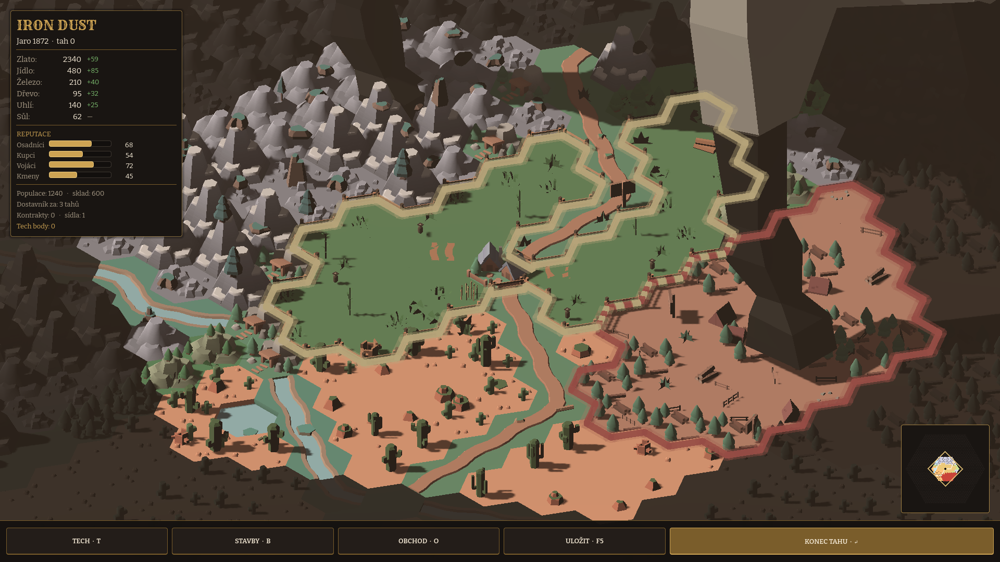

# Iron Dust

Turn-based strategy on an isometric hex map. American frontier, spring 1872: you start with
one settlement, a bit of gold and a lot of empty land, and grow from there through building,
trade and the occasional fight over territory.

## What's in

- Hex grid with an isometric camera, procedurally built island map (mountains, rivers, desert, forest)
- Ownership and borders, settlements, combat, trade
- Economy with per-turn income for gold, food, iron, wood, coal and salt
- Reputation with four factions: settlers, merchants, soldiers, tribes
- Animals and settlers walking around the map
- Main menu, save/load

Still early. The UI is in Czech for now. Next steps are in [docs/ROADMAP.md](docs/ROADMAP.md):
production chains, player-built railways and an AI opponent that adapts to the player.

## Running it

Open `project.godot` in [Godot 4.7](https://godotengine.org/) and press F5.

## Credits

3D tiles and buildings: [Kenney Hexagon Kit](https://kenney.nl/assets/hexagon-kit) (CC0).
Fonts: Rye and Bitter (SIL Open Font License, see `assets/fonts`).
